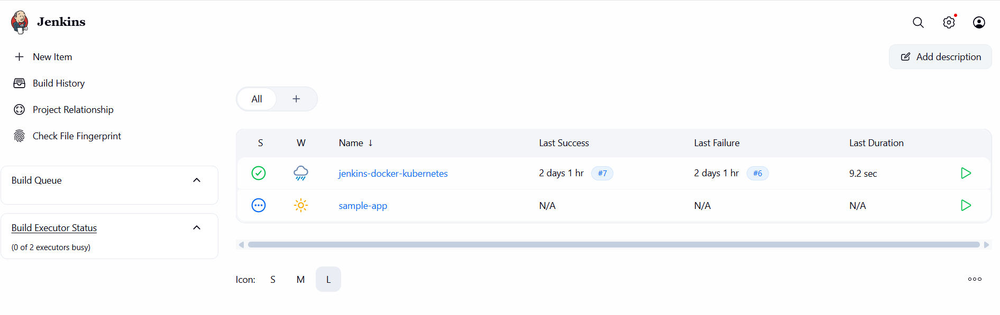
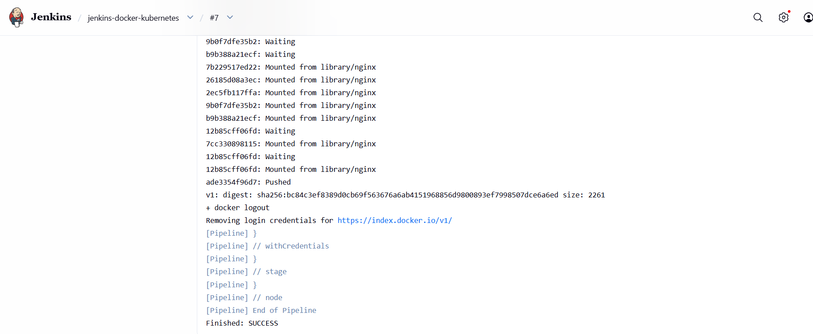
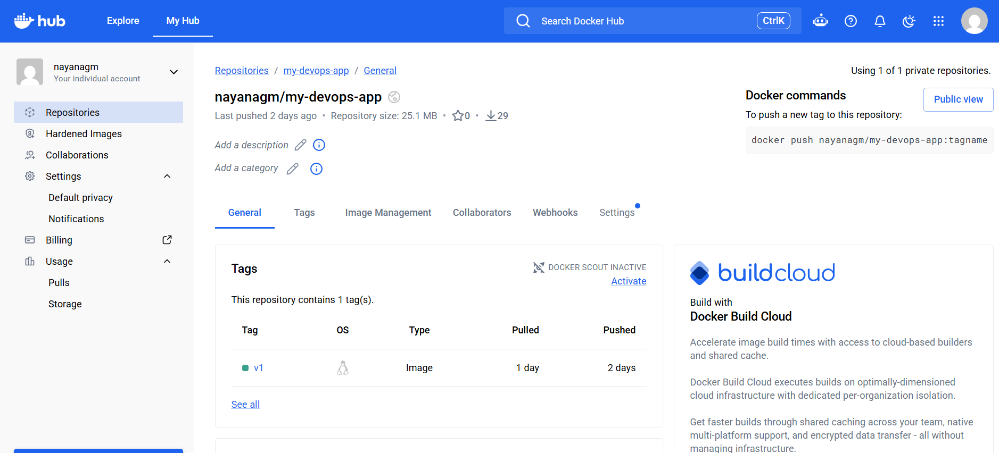
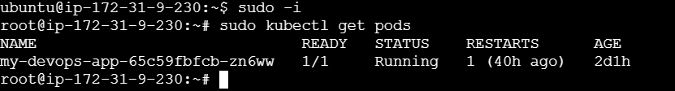
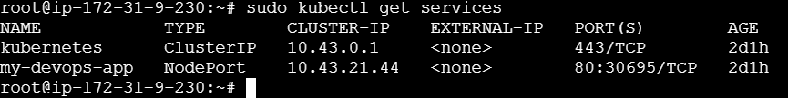
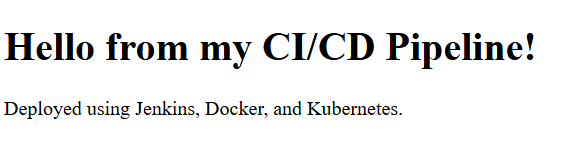

# AWS-Based CI/CD Pipeline Using Jenkins, Docker and Kubernetes

## 1. Project Overview

This project demonstrates how to build and deploy a web application using AWS EC2, Jenkins, Docker and Kubernetes.

The project automates source code checkout, Docker image creation and image publishing through a Jenkins CI/CD pipeline. The application is then deployed manually to a Kubernetes cluster running on AWS EC2.

## 2. Technologies Used

* AWS EC2
* Ubuntu Linux
* Git and GitHub
* Jenkins
* Docker
* Docker Hub
* Kubernetes (k3s)
* HTML

## 3. Project Architecture

Developer → GitHub → Jenkins → Docker Build → Docker Hub → Kubernetes Deployment → Web Application

## 4. Project Workflow

1. Created an AWS EC2 instance with Ubuntu Linux.
2. Installed and configured Jenkins and Docker.
3. Stored application source code in GitHub.
4. Configured Jenkins to checkout the latest source code.
5. Built a Docker image using a Dockerfile.
6. Pushed the Docker image to Docker Hub.
7. Installed Kubernetes (k3s) on the EC2 instance.
8. Deployed the Docker image using a Kubernetes Deployment.
9. Exposed the application using a NodePort Service.
10. Accessed the deployed website through the EC2 public IP address.

## 5. Project Screenshots

### Jenkins Dashboard



### Jenkins Successful Build



### Docker Hub Image



### Kubernetes Running Pods



### Kubernetes Services



### Deployed Website



## 6. Important Commands

```bash
# Check Docker version
docker --version

# Build Docker image
docker build -t my-devops-app:v1 .

# Check Kubernetes pods
sudo kubectl get pods

# Check Kubernetes services
sudo kubectl get services

# Check Kubernetes nodes
sudo kubectl get nodes
```

## 7. Project Outcome

Successfully built a Jenkins CI/CD pipeline to automate source code checkout, Docker image building and Docker Hub publishing. Deployed the containerized web application on Kubernetes and accessed it through an AWS EC2 instance.

## 8. Learning Outcomes

* Understanding CI/CD concepts.
* Working with Git and GitHub.
* Building and managing Docker images.
* Using Jenkins pipelines.
* Understanding Kubernetes Deployments, Pods and Services.
* Hosting applications on AWS EC2.
